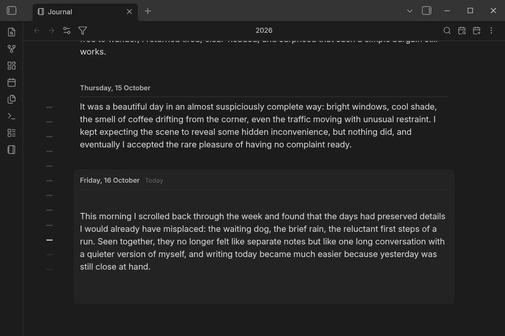

# Journal View (Wren)

This is Wren's fork of [RUverse's Journal View](https://github.com/RUverse/journal-view), with
opinionated design changes inspired by Reflect. It brings your daily notes together in one
scrollable, editable timeline, so revisiting the past and writing today feel like part of the same
story.

The fork keeps upstream's features and adds more control over the journal's headings, spacing,
today's card, and navigation. It also includes Completed Tasks support, expanded text selection,
and extra care around saving edits.

  

Open Journal View from the sidebar or run **Open journal** from the command palette.

- **Use the daily notes you already have.** Journal View works with your existing notes and daily-note
  settings—no plugin-specific formats, duplicate files, or lock-in.
- **Navigate through time with ease.** Scroll through your journal, jump to any date with the calendar,
  return to today in one click, open a random past day, or open the surrounding days from the
  notebook button on a daily note.
- **Edit directly in the timeline.** Read and write without switching between files, views, or editing
  modes.
- **Write only when there is something to say.** Start typing on an empty day and Journal View creates
  the daily note only when you need it.
- **Rediscover past entries.** Search across your journal, and see how much you have written over the
  years in statistics, including a mosaic of the words you used for the first time each month.
- **Focus the timeline.** Filter daily notes by tags or exact property values, with include and
  exclude rules that also carry through to calendar navigation and journal search.
- **See what else each day held.** Optionally list the files you created or edited on each day.
- **Stay responsive across years of notes.** Journal View keeps the days around you ready to edit
  while efficiently handling the rest of your timeline.

## Settings

Journal View uses your existing daily-note configuration by default. You can override the date
format, folder, and template in **Settings → Journal View** without changing how the rest of your
vault handles daily notes.

Some display options are also in the customization menu, opened from the journal toolbar. The
[guide](docs/guide.md#settings) lists every option and its default, including the fork's own:

| Setting | Default | What it does |
| --- | --- | --- |
| Hide today's background | Off | Replaces today's shaded card with a date heading in the theme's bold or italic colour |
| Open note control | Show button | Keeps the open-note button, hides it, or opens the note by selecting its daily heading |
| Hide header separator | Off | Removes the line between each daily heading and its note contents |
| Hide note H1 heading | Off | Hides a leading H1 in the journal while keeping it in the daily note file |
| Go to note position | Bottom | Chooses Top, Bottom, or Auto for the day commands and toolbar Today button. Auto uses Top for 20+ lines, otherwise Bottom |

## Learn more

The [guide](docs/guide.md) covers each part of Journal View in detail:

- [Navigation](docs/guide.md#navigation): going to a date, a random entry, and the date commands
- [Settings](docs/guide.md#settings): every option and its default
- [Several notes a day](docs/guide.md#several-notes-a-day): notes with text or a time after the date
- [File modification history](docs/guide.md#file-modification-history): the files listed under each day
- [Editing and completed tasks](docs/guide.md#editing-and-completed-tasks): conflict copies, retries, selection, and Completed Tasks
- [Filters](docs/guide.md#filters): tag and property rules
- [Statistics](docs/guide.md#statistics): the year mosaic and new words

## Install this fork

Download `main.js`, `manifest.json`, and `styles.css` from the latest
[Wren release](https://github.com/turnipsforme/journal-view/releases). Put all three files in
`.obsidian/plugins/journal-view-wren/` inside your vault, then enable **Journal View (Wren)** in
Obsidian's community plugin settings. Its plugin ID is `journal-view-wren`, so Obsidian treats it
as a separate plugin from RUverse's Journal View.

## Bringing in upstream changes

The Git history keeps the upstream commits. To bring in a future RUverse release, run
`git fetch upstream --no-tags` and merge `upstream/main` on a new branch, resolve any conflicts,
then build and test the result. Keep this fork's `manifest.json` identity and design choices when
resolving conflicts. [AGENTS.md](AGENTS.md) lists where the fork differs from upstream and what to
re-check after a merge.

## Privacy

Journal View works locally with files in your Obsidian vault. It does not make network requests,
collect telemetry, require an account, or access files outside your vault.

## License

[MIT](LICENSE) © 2026 RUverse and Wren. The original plugin is by RUverse.
